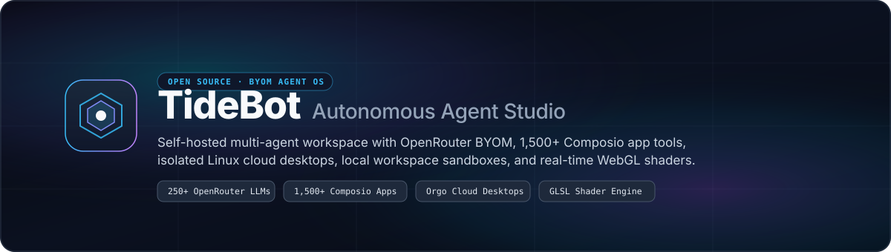
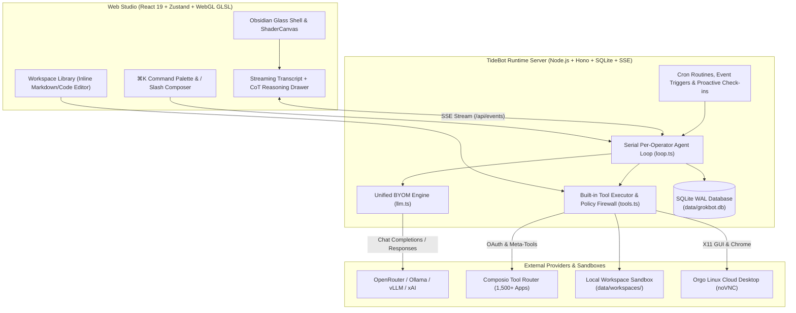

<p align="center">
  
</p>

<p align="center">
  <a href="LICENSE"></a>
  <a href="https://openrouter.ai"></a>
  <a href="https://composio.dev"></a>
  <a href="https://nodejs.org">= 22"></a>
  <a href="#quick-start"></a>
</p>

<p align="center">
  <strong>TideBot</strong> is a self-hosted, open-source <strong>Autonomous Multi-Agent Studio</strong>.<br>
  Deploy persistent AI Operators with <strong>Bring Your Own Model (BYOM)</strong> via OpenRouter, Ollama, vLLM, or xAI, connect <strong>1,500+ external apps</strong> through Composio, and execute real work across local workspace sandboxes and full Linux cloud desktops.
</p>

<p align="center">
  <a href="#-key-features">Key Features</a> ·
  <a href="#-architecture">Architecture</a> ·
  <a href="#-quick-start">Quick Start</a> ·
  <a href="#-bring-your-own-model-byom">Bring Your Own Model</a> ·
  <a href="#-built-in-operator-tools">Built-in Tools</a> ·
  <a href="AGENTS.md">AGENTS.md</a>
</p>

---

## ✨ Key Features

### 🧠 Bring Your Own Model (First-Class OpenRouter & Local LLM Support)
- **Hot-Swappable Model Engine**: Switch between **OpenRouter** (`https://openrouter.ai/api/v1`), **Custom OpenAI-Compatible Endpoints** (Ollama, LM Studio, vLLM, Groq, Together), and **xAI Responses API** directly from the UI without restarting the server.
- **Per-Operator Model Overrides**: Assign specialized models per Operator (e.g., `anthropic/claude-3.7-sonnet` for coding, `google/gemini-2.5-pro` for 1M-context research, `deepseek/deepseek-r1` or `thinkingmachines/inkling-2-small:free` for chain-of-thought reasoning).
- **Live Chain-of-Thought Drawer**: Streams `delta.reasoning` in real time into a collapsible **Thought Process** drawer with per-turn latency and model telemetry badges.

### 🔌 1,500+ Connected Apps via Composio
- **OAuth App Marketplace**: Connect Gmail, Google Calendar, GitHub, Slack, Notion, Linear, Jira, Google Drive, and 1,500+ toolkits via Composio's managed OAuth flow.
- **Granular Approval Firewall**: Read-only operations execute seamlessly; state-mutating actions pause the turn and render an interactive **Approval Card** (`Allow Once`, `Always Allow`, `Deny`).

### 🖥️ Dual Execution Sandbox (Local Workspace + Orgo Cloud Linux VM)
- **Zero-Config Local Workspace**: Works out of the box without a cloud VM—each Operator gets an isolated local workspace directory (`data/workspaces/<botId>/`) for instant `shell` execution, `save_file`, `read_file`, and `list_files`.
- **Full Cloud Linux Desktops (Orgo)**: When `ORGO_API_KEY` is configured, Operators can spin up and control isolated X11 Linux desktops with persistent Chrome profiles, live screenshots, mouse/keyboard automation, and an interactive **noVNC Live Viewer** (`Watch` or `Take Control`).

### 🎨 Obsidian Glass UI & Real-Time WebGL Shaders
- **5 Procedural GLSL Shaders**: Hardware-accelerated, zero-dependency WebGL fragment shaders (`Aurora`, `Plasma`, `Obsidian`, `Vortex`, `Grid`) capped at 30 FPS and `0.6x` resolution scaling with automatic `IntersectionObserver` pause when off-screen.
- **Command & Model Palette (`⌘K`)**: Search across Operators, messages, memories, and tasks, switch models on the fly, clone Operators, or export conversations to Markdown.
- **Interactive `/` Slash Palette**: Type `/search`, `/fetch`, `/file`, `/draft`, `/task`, `/routine`, `/apps`, `/models`, `/fast`, `/deep`, or `/clear` right in the composer.

---

## 🏗 Architecture



---

## 🚀 Quick Start

### 1. Prerequisites
- **Node.js 22.0+** and `npm`

### 2. Clone & Install

```bash
git clone https://github.com/asjames18/tidebot.git
cd tidebot
npm install
cp .env.example .env
```

### 3. Configure `.env` (or Configure Directly in the UI)

Open `.env` and add your API keys (or start the server first and paste your keys into **Settings → Models & OpenRouter** in the web UI):

| Variable | Required | Description |
| :--- | :---: | :--- |
| `LLM_PROVIDER` | No | `openrouter` (default), `custom`, or `xai` |
| `OPENROUTER_API_KEY` | Recommended | OpenRouter key (`sk-or-v1-...`) for 250+ frontier & free models |
| `OPENROUTER_MODEL` | No | Default model ID (e.g., `thinkingmachines/inkling-2-small:free` or `anthropic/claude-3.7-sonnet`) |
| `LLM_BASE_URL` | Optional | Custom OpenAI-compatible base URL (e.g., `http://localhost:11434/v1` for Ollama) |
| `COMPOSIO_API_KEY` | Optional | Composio key (`ak_...`) for 1,500+ OAuth app integrations |
| `ORGO_API_KEY` | Optional | Orgo key (`sk_live_...`) for cloud Linux desktops (falls back to local workspace if omitted) |
| `SESSION_SECRET` | Recommended | Random 32-byte hex secret (`openssl rand -hex 32`) |
| `DEV_LOGIN` | Local Dev | Set to `1` to enable instant local email sign-in |

> **Hot-Reloading `.env`**: TideBot watches `.env` by modification timestamp (`mtimeMs`). Any key added or updated in `.env` or via the Settings UI takes effect **immediately** without restarting the server.

### 4. Start Development Servers

Run the backend and frontend in two terminals:

```bash
# Terminal 1 — Backend API & Agent Runtime (http://localhost:8787)
npm run dev -w server

# Terminal 2 — Web Studio (http://localhost:5173)
npm run dev -w web
```

Then open **[http://localhost:5173](http://localhost:5173)**.

### Production Build

```bash
npm run typecheck
npm run build
npm start
```

In production mode (`npm start`), the Hono server serves both the compiled SPA and `/api/*` on `http://localhost:8787`.

---

## 🧰 Built-in Operator Tools

Every TideBot Operator has access to structured built-in tools alongside any connected Composio apps:

| Tool Name | Category | Description |
| :--- | :--- | :--- |
| `web_search` | Web Research | Searches the live web and returns structured titles, URLs, and snippets. |
| `fetch_webpage` | Web Research | Fetches any `https://` URL and extracts clean readable text/JSON in `<1s`. |
| `save_file` | Workspace Library | Saves markdown reports, notes, CSVs, or code to the Operator's Library. |
| `read_file` / `list_files` | Workspace Library | Reads and lists files inside the Operator's Library workspace. |
| `shell` | Execution | Runs bash commands, scripts, and CLIs inside the local workspace or cloud VM. |
| `draft_message` | Communication | Renders an interactive **Email / Slack / Message Draft Card** in chat for review. |
| `ask_user` | Human-in-the-Loop | Renders a multiple-choice **Question Card** and pauses until answered. |
| `create_task` / `update_task` | Project Management | Tracks multi-step work on the **Operator Tasks Command** board. |
| `create_routine` / `create_event_routine` | Automation | Schedules recurring 5-field cron jobs or Composio webhook event triggers. |
| `remember` / `recall` | Long-Term Memory | Stores and retrieves durable facts across conversations. |
| `send_to_bot` / `spawn_subagent` | Multi-Agent | Delegates subtasks to teammate Operators or parallel helper subagents. |
| `computer_*` / `open_browser` | Cloud Desktop | Full X11 screen screenshot, click, type, scroll, drag, and persistent Chrome (when `ORGO_API_KEY` is configured). |

---

## ⌨️ Keyboard Shortcuts & Slash Commands

| Shortcut / Command | Action |
| :--- | :--- |
| `⌘K` / `Ctrl+K` | Open **TideBot Command & Model Palette** |
| `⌘I` / `Ctrl+I` | Focus message composer |
| `⌘B` / `Ctrl+B` | Toggle left Operator dock |
| `⇧⌘,` / `Ctrl+Shift+,` | Toggle right Operator Inspector & Library panel |
| `⌘,` / `Ctrl+,` | Open **TideBot Studio Settings & BYOM** |
| `Alt+N` / `⇧⌘O` | Deploy a new Operator |
| `/search`, `/fetch`, `/file`, `/draft` | Insert structured tool prompts in the composer |
| `/fast` / `/deep` | Switch active Operator between `Low` (fastest) and `High` (deep CoT) reasoning effort |
| `/apps` / `/models` / `/clear` | Open Composio Marketplace, BYOM Settings, or reset conversation |

---

## 📂 Repository Structure

```text
tidebot/
├── server/
│   └── src/
│       ├── agent/
│       │   ├── llm.ts          # Unified OpenRouter, Custom OpenAI & xAI engine
│       │   ├── loop.ts         # Per-Operator serial turn queue, tool runner & approvals
│       │   ├── tools.ts        # Built-in tools, local sandbox & Orgo desktop bridge
│       │   ├── memory.ts       # Idle memory consolidation & history compaction
│       │   ├── prompt.ts       # Dynamic system prompt builder
│       │   ├── rooms.ts        # Multi-Operator war room router
│       │   └── subagents.ts    # Parallel helper subagent lifecycle
│       ├── composio.ts         # Live Composio v3.1 catalog, OAuth & tool router
│       ├── computer.ts         # Orgo VM lifecycle & multi-screen lease manager
│       ├── routes.ts           # Core REST & SSE API routes
│       ├── routes-config.ts    # BYOM config, skills, library files & memory APIs
│       └── db.ts               # SQLite WAL schema & migrations
├── web/
│   └── src/
│       ├── components/
│       │   ├── ShaderCanvas.tsx    # 5 procedural WebGL GLSL background shaders
│       │   ├── ChatView.tsx        # Chat header, live model switcher & transcript host
│       │   ├── Transcript.tsx      # Grouped bubbles, CoT reasoning drawer & telemetry
│       │   ├── Composer.tsx        # Auto-grow input, / slash palette & footer bar
│       │   ├── config/             # BYOM settings, Library editor & Tasks Command view
│       │   └── modals/             # ⌘K palette, Composio marketplace & Operator modals
│       ├── avatar/BotAvatar.tsx    # Holographic 3D geometric Operator cores
│       └── styles/                 # Obsidian Glass dark & Alabaster light CSS tokens
├── AGENTS.md                   # Architecture & contributor guide for AI coding agents
└── .env.example                # Environment variable template
```

---

## 🤝 Contributing

Contributions, issues, and feature requests are welcome!
1. Fork the repository and create a feature branch (`git checkout -b feat/amazing-capability`).
2. Run verification before committing:
   ```bash
   npm run typecheck && npm run build
   ```
3. Ensure no secrets, `.env` files, or SQLite `.db` files are staged.
4. Open a Pull Request.

See [`AGENTS.md`](AGENTS.md) for detailed architectural invariants and coding guidelines.

---

## 📄 License

Released under the [MIT License](LICENSE).
